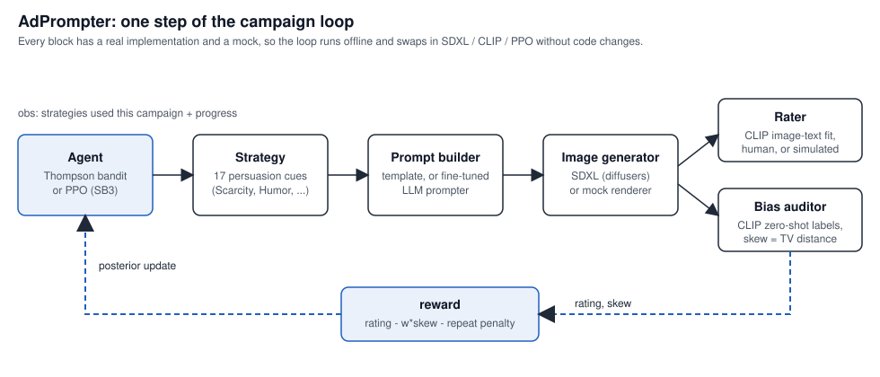
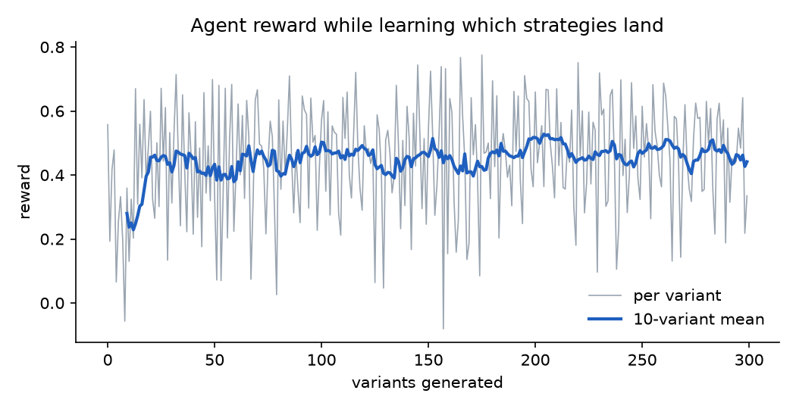
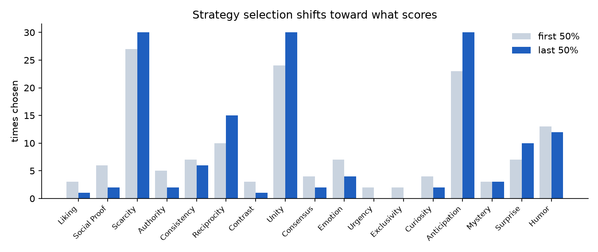
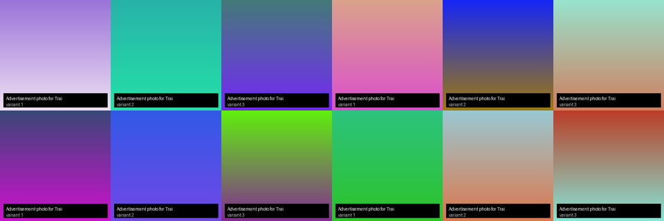
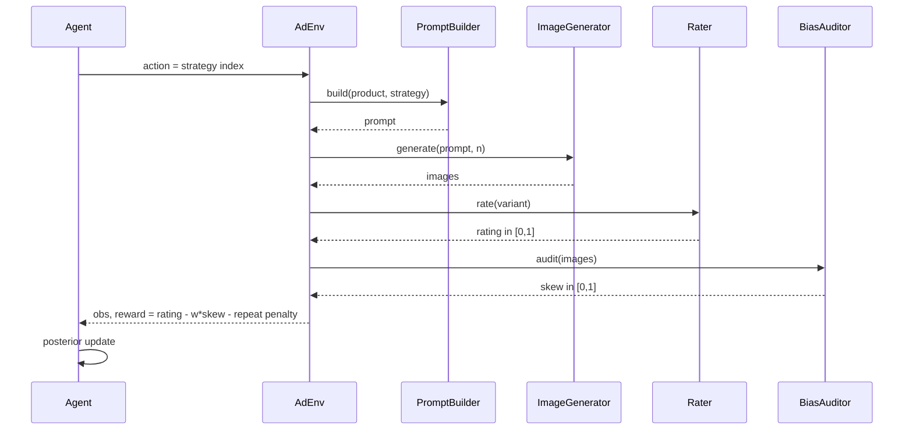

# AdPrompter

An RL loop that learns **which persuasion strategy to prompt an image model with**, scored by
automatic rating and a demographic-bias audit. Each step the agent picks a strategy
(Scarcity, Social Proof, Humor, ...), the pipeline renders ad variants for it, scores them,
and the agent updates. Over a few campaigns it converges on the strategies that score well
*and* stay balanced.

Runs fully offline out of the box (mock renderer, simulated ratings). Swap in Stable Diffusion
XL, CLIP, a fine-tuned prompter, or a PPO policy with flags; the loop does not change.



## Results (offline run, 60 campaigns, 300 variants)

```
adprompter --product "Trail Runner X" --feature "carbon plate" --feature "280g" \
           --feature "all-weather grip" --episodes 60 --seed 7
```

| | first 10 campaigns | last 10 campaigns |
|---|---|---|
| mean reward per variant | 0.402 | **0.468** (+16%) |
| first pick of a campaign = reward-optimal strategy | - | **28 / 30** (93%) |



The agent settles within ~30 variants. The noise band is the simulated rater (σ = 0.08) plus
the bias penalty.



**The agent did not pick the highest-rated strategy, and that is the point.** The simulated
oracle rates *Anticipation* highest (0.78), but its variants carry demographic skew (excess
skew 0.50), so after the bias penalty it is worth 0.53. *Scarcity* rates 0.66 with almost no
skew (0.06) and is worth 0.63, the best reward-adjusted arm, and that is what the agent
learned to lead with.

| strategy | rating | excess skew | reward-adjusted |
|---|---|---|---|
| Scarcity | 0.66 | 0.06 | **0.628** |
| Anticipation | 0.78 | 0.50 | 0.529 |
| Unity | 0.56 | 0.06 | 0.527 |
| Humor | 0.64 | 0.50 | 0.389 |



*Contact sheet from the mock renderer: deterministic gradients labelled with product and
variant. Pass `--sdxl` for real images.*

## How it works



**Environment** (`env.py`). One episode is a short campaign of `horizon` variants. The
observation is which strategies have been used plus progress through the campaign, which is
all a policy needs to avoid repeats and pace itself. Reward is the rating minus a weighted
bias skew minus a penalty for repeating a strategy inside one campaign.

**Agent** (`agent.py`). The default is a Gaussian Thompson-sampling bandit: it samples a
plausible quality for each strategy from its posterior, masks arms already used this
campaign, and plays the best. No learning rate, no schedule. `--ppo` swaps in a PPO policy via
stable-baselines3 through a thin gymnasium adapter.

**Prompting** (`prompting.py`). A template builder maps each strategy to a concrete visual
cue (`strategies.py`) and the product's features into a Stable-Diffusion-style prompt. With
`--llm-prompts` a causal LM fine-tuned on ad prompts expands the same seed.

**Rating** (`rating.py`). `CLIPRater` scores image-text fit between each variant and its own
prompt; `HumanRater` asks on the terminal; `SimulatedRater` is the oracle for tests and
offline runs (hidden per-strategy quality plus noise).

**Bias audit** (`bias.py`). Zero-shot CLIP labels every image for gender, age and skin tone;
`skew` is the total-variation distance from a uniform distribution (0 balanced, 1 one group
only). A handful of images can never be exactly uniform, so `excess_skew` subtracts the
chance level (the expected skew of n fair draws) and the worst attribute is what gets
penalised. Images are generated, so the audit is on what *this* prompt produces, not on a
dataset.

Every block has a real implementation and a mock behind the same `Protocol`, so the whole loop,
the tests, and the figures above run with numpy, pillow and matplotlib alone.

## Install

```bash
pip install -e .                 # offline mode: numpy, pillow, matplotlib
pip install -e ".[sdxl,clip]"    # real images + automatic rating (GPU recommended)
pip install -e ".[rl]"           # PPO policy
```

## Run

```bash
adprompter --product "Trail Runner X" --feature "carbon plate" --episodes 20
adprompter --product "Trail Runner X" --sdxl --clip --episodes 10 --images 4
adprompter --product "Trail Runner X" --human --images 2 --episodes 3
adprompter --product "Trail Runner X" --ppo --ppo-steps 2000   # each PPO step is a render
```

Each run writes `records.json`, `reward_curve.png`, `strategy_mix.png`, `contact_sheet.png`
and the variant images to `--out` (default `runs/latest`).

```bash
pytest tests -q   # offline loop, repeat/skew penalties, bandit posterior, learning, file layout, CLI
```

## Layout

```
adprompter/
  strategies.py   17 persuasion strategies and their visual cues (action space)
  types.py        Product, Variant
  prompting.py    TemplatePromptBuilder, LLMPromptExpander
  imaging.py      MockGenerator, SDXLGenerator
  rating.py       SimulatedRater, HumanRater, CLIPRater
  bias.py         skew(), excess_skew(), MockAuditor, CLIPAuditor
  env.py          AdEnv, used_mask(), gym_adapter()
  agent.py        ThompsonAgent, PPOAgent
  pipeline.py     run_campaign -> records + saved variants
  report.py       reward curve, strategy mix, contact sheet
  cli.py
tests/
docs/             architecture.svg, results/
```

## Notes

- API keys for any hosted model are read from the environment by the underlying libraries;
  nothing is stored in this repository.
- Grew out of a CSE 574 (ASU) course project on generative ads; this is a ground-up rewrite
  with a corrected environment, a real bias audit, and an agent that converges.

MIT. Devanshu Gupta.
